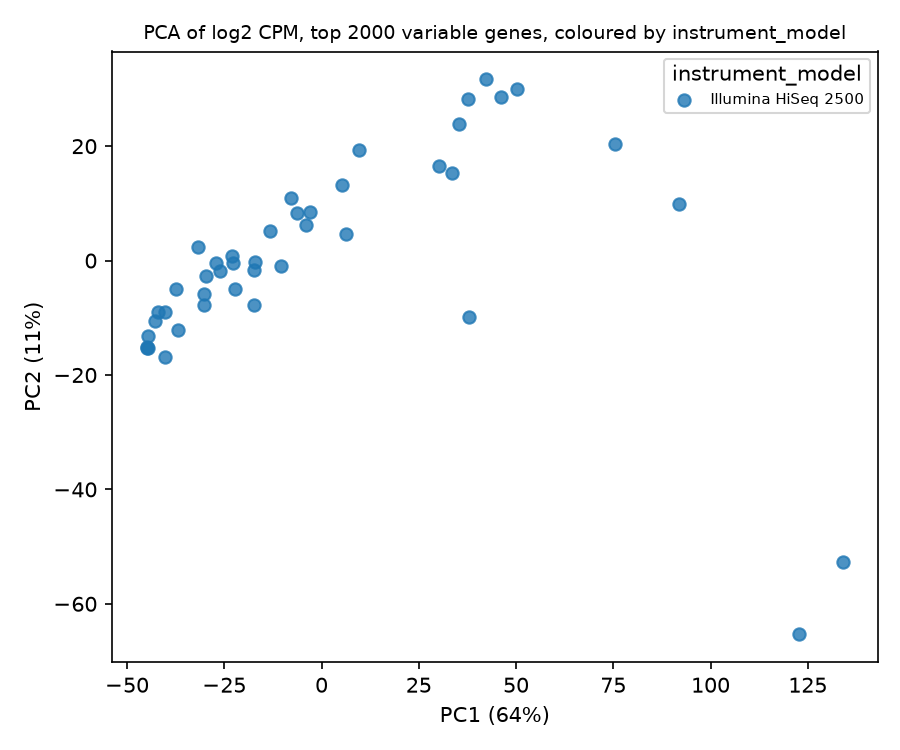
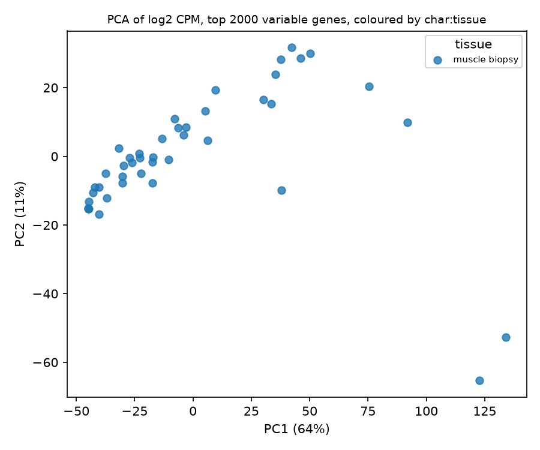
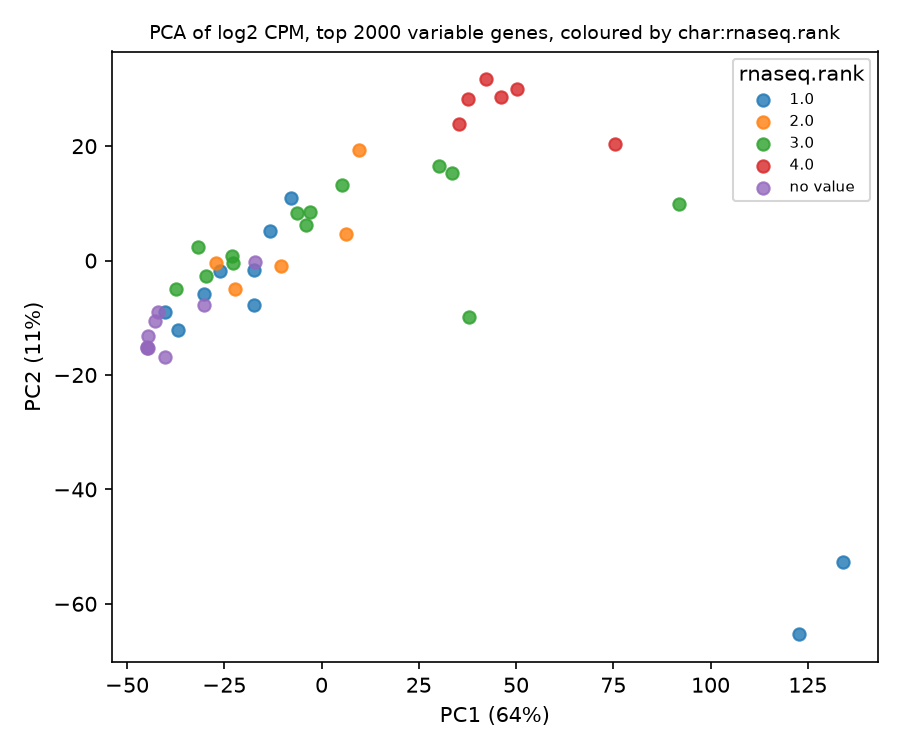

# Step 2: quality control and exploration

*Worksheet. Fill it as you work and commit it with your code. Your report on UNESS cites it as evidence.*

## Filtering

| Filter | Threshold I chose | Why | Samples and genes before | after |
|The default rule (retain genes with at least n raw counts in at least 9 samples (smallest group)|10 | I tried 3 tresholds 1, 5, and 10; If I choose more than 10, I lose some of the 4 biomarkers; If I choose 1, filtering removes very little nb of genes; I was hesitant between 5 and 10. If I want to answer the 4 tasks of the project I choose 10 because I mainly need the 4 biomarkers, but If I want to reproduce all the authors results, I would choose 5 because I would retain the 54 genes not only 4. This rule is recommended in DEseq2|43 samples and 27506 genes before|43 samples and 19258 genes|
| | | | | |

Does the paper state its thresholds? Quote them if it does, say so if it does not. It does not.
Do the four biomarker genes of the paper pass your filter? yes

## Exploration

Figures (in `results/step2_qc/`): 

- PCA coloured by condition: 

- PCA coloured by each technical variable: 

- PCA coloured by the authors' group (`rnaseq.rank`): 

Name the variable that separates the samples on PC1, then on PC2: the condition,
a technical variable, the authors' group, or none you can name. Give the variance
PC1 and PC2 explain. 

PC1 explains 64% and PC2 11% of the variance.
Condition separates on PC1 and PC2
rnaseq.rank separates on PC1 and PC2 mainly controls and group 4 from other groups (group 1, 2 , and 3 are in the same space where slight separation can be seen )
Batch partially separates batch I (blue dots) on pc1 and pc2 but I cannot really say there's a batch effect or at least it is recoverable. What is reassuring is that group 4 FSHD patients where divided into 2 batches I and III. 

Compare your PCA with Figure 3 of the paper. The same or not, and why: 

In the paper, it was not clear how did they performed the PCA, if they filtered and selected top 2000 features and how did they normalize the data. We understand implicitly that neither filter was applied nor feature selection was implemented. We can see this reflecting on the scores and percentage of variance explained by PC1 and PC2 (in relation to the noise diluting every distance, correlation between genes and the curse of dimensionality). In the paper PC1 explains 38% of variance whereas PC2 14% ; 
However, the separation between controls and the 4 FSHD subgroups based on RNA seq is more or less similar. With 2 similar outliers representing sample 320016 and sample 01-0037 of group 1 FSHD patients (as detected by their scores on pca_scores.csv). Groups 1, 2, 3, 4 separate progressively from the control group as seen in figure 3 of the paper where group 4 is the most separated group on both PC1 and PC2. 

## Samples I excluded, and why
Based on the PCA results, I exclude the 2 outliers: sample 320016 and sample 01-0037 
They showed very high score on pc1 and very low score on pc2, unlike all other samples. 
-

## Decisions I made

-Remove 2 outliers from raw counts or metadata and filtered counts? 
-Decide on how to remove them and what steps should I rerun
-Slight Batch effect which is recoverable

