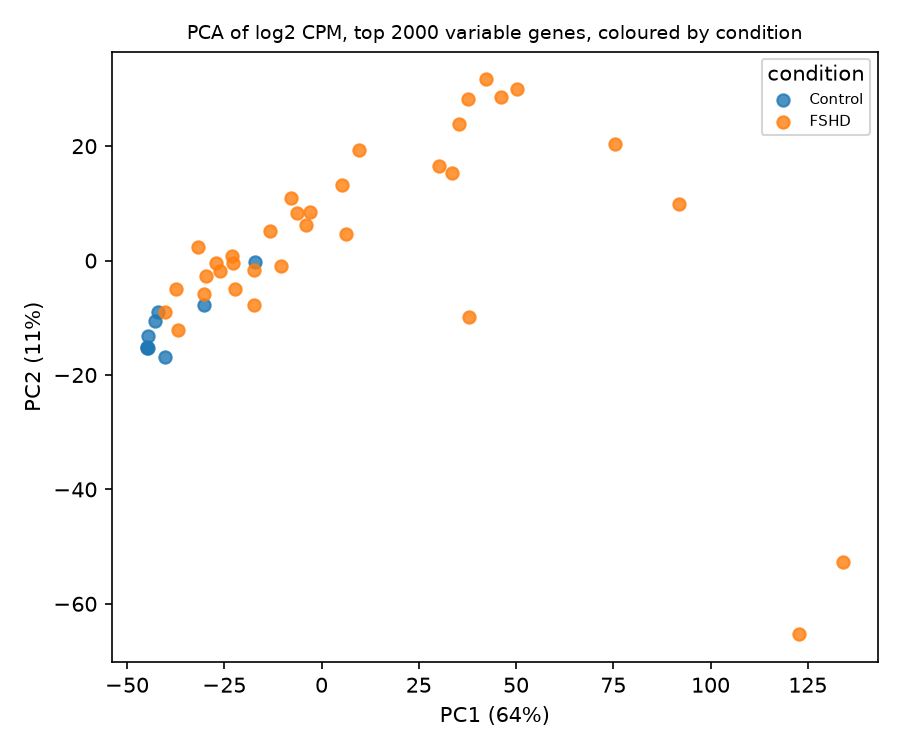
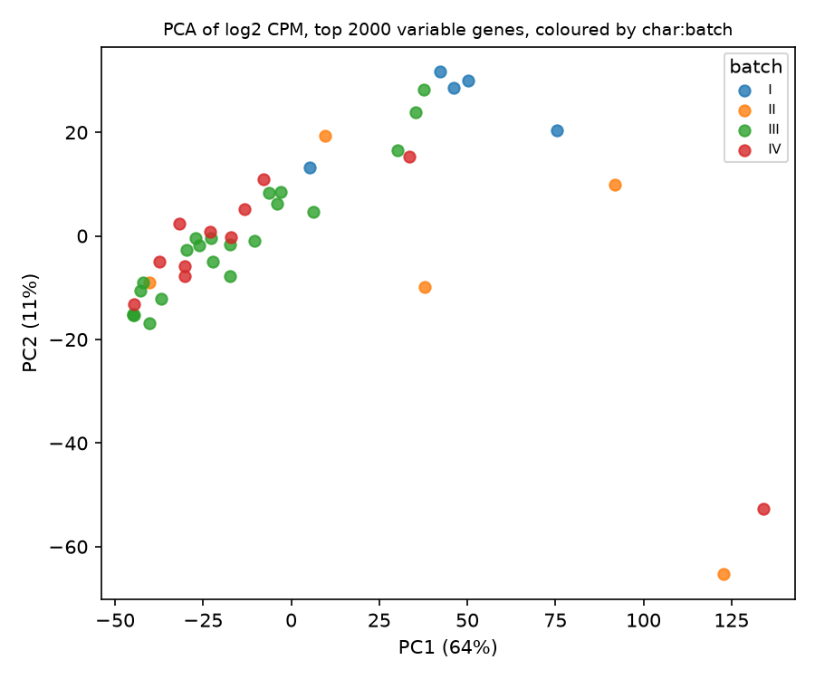

# Step 2: quality control and exploration

*Worksheet. Fill it as you work and commit it with your code. Your report on UNESS cites it as evidence.*

## Filtering

| Filter | Threshold I chose | Why | Samples and genes before | after |
|The default rule (retain genes with at least n raw counts in at least 9 samples (smallest group)|10 | I tried 3 tresholds 1, 5, and 10; If I choose more than 10, I lose some of the 4 biomarkers; If I choose 1, filtering removes very little nb of genes; I was hesitant between 5 and 10. If I want to answer the 4 tasks of the project I choose 10 because I mainly need the 4 biomarkers, but If I want to reproduce all the authors results, I would choose 5 because I would retain the 54 genes not only 4. This rule is recommended in DEseq2|43 samples and 27506 genes before|43 samples and 19258 genes|
| | | | | |

Does the paper state its thresholds? Quote them if it does, say so if it does not. It does not.
Do the four biomarker genes of the paper pass your filter? yes

## Exploration

Figures (in `results/step2_qc/`):

- PCA coloured by condition: 

- PCA coloured by each technical variable: 

- PCA coloured by the authors' group (`rnaseq.rank`): 

Name the variable that separates the samples on PC1, then on PC2: the condition,
a technical variable, the authors' group, or none you can name. Give the variance
PC1 and PC2 explain.

Compare your PCA with Figure 3 of the paper. The same or not, and why:

## Samples I excluded, and why

-

## Decisions I made

-
